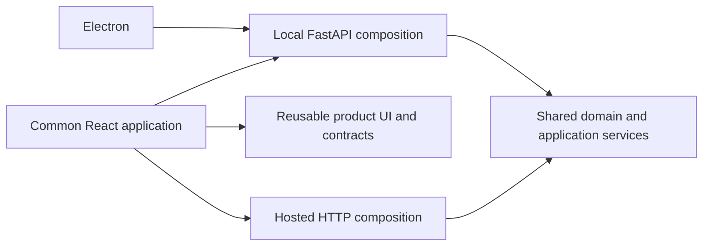

# Repository boundaries

Animama owns the local desktop and self-host application, reusable product code,
public artifact contracts, tests and contributor documentation. It builds and
runs without a private Cloud checkout, hosted credentials or private plans.
Original work is licensed AGPL-3.0-only; third-party material keeps its own
terms. Repository ownership does not grant permission to publish or
redistribute a file.

## Code and data ownership



Shared Python domain/application code accepts explicit owners, ports, policies
and units of work. It must not import the local or HTTP composition, configure
logging, read installation state or initialize databases. The local app factory
owns those effects, installs the request-principal resolver and authorizes
requests before resolving the generated installation owner.

The local Alembic graph owns the accountless installation schema. Existing
`user_id` columns remain installation ownership columns. A hosted
consumer provides its own identity resolution, migrations, bootstrap, storage,
providers and tenant/quota policy. It must not read local installation tables or
choose an owner from client headers. Hosted services are not local dependencies.

The common web application uses explicit local and hosted entrypoints with the
same router, screens, creators and voice/avatar runtime. A composition supplies
admission, transport and owner/session context; the local adapter owns installation
readiness and Electron integration. The hosted capability contract excludes only
the [six agreed operation groups](../../contracts/hosted-web.md#capabilities-and-requests).
The whole app is built from `web`; it does not require extracting every screen
into an npm package. Package source still cannot import `web`, `desktop`, private
aliases or a sibling checkout.

## Stable artifact boundary

| Artifact                     | Responsibility                                                                                                             |
| ---------------------------- | -------------------------------------------------------------------------------------------------------------------------- |
| Hosted application archive   | Complete immutable browser application, closed static/resource inventory and separately admitted non-static Included seed. |
| Landing site archive         | The static animama.ai site with its closed file, MIME and cache inventory and `_headers` digest (package-set format 3).    |
| Python wheel                 | Reusable backend domain/application contracts and supported provider adapters.                                             |
| `@animama/runtime-contracts` | Runtime owner, transport and capabilities; generated API types, SDK and validators; supported UI Locales and resolution.   |
| `@animama/product-ui`        | Injected product providers, Anima selection, chat session/stream behavior, transcript, composer and the UI Locale runtime. |
| `@animama/discover-client`   | Inert compatibility package retained in the artifact set. Discover and local account connection are discontinued.          |

Consumers pin immutable commits and complete application/site/wheel/npm/contract identities.
Public builds do not read the private lock or require its checkout. The current
package set and wire contracts remain stable through local cleanup; see
[contracts](../../contracts/README.md) and
[artifact tooling](../../scripts/package-sets/README.md).

Boundary checks build and install artifacts outside the checkout. They exercise
shared services with controlled ports and the emitted application through an
independent cookie/CSRF HTTP fixture, including real VRM and browser speech bytes.
These tests establish artifact portability and bounded browser behavior. Hosted
deployment, physical audio, native release acceptance and publication rights
require separate evidence.

## Contributor documentation

- [Backend](../backend/README.md): APIs, content, persistence and operations.
- [Frontend](../frontend/README.md): browser and desktop implementation.
- [Deployment topology](deployment-topology.md): supported serving arrangements.
- [Discover compatibility](discover-contract-ownership.md): retained inert surface.

New specs and ExecPlans are tracked with the implementation they cover: Animama
uses [PLANS.md](../../PLANS.md) and `docs/plans/`; Cloud owns its own plans. Public
plans contain reviewable engineering context, decision summaries and validation
results without private dependencies. Historical plans, split evidence, sensitive
backlog and raw approval records remain in their existing private locations unless
deliberately reviewed for migration. Preserve existing gates. Private material is
not a local build or contributor prerequisite, and plan location grants no
publication authority.

## Source review and licensing

Preserve third-party licenses, notices and attribution alongside their source.
Every tracked file has one entry in
[the source-license review](../../licenses/source-review.json);
[the coverage check](../../scripts/public-release/README.md) lists files without
an entry and entries for removed files. Update the entries in the same change
that adds, moves or deletes files.

Secret scans, license detection and successful builds do not grant redistribution
permission. Pending rights questions must be resolved before the files that carry them
are published. Raw-asset permission and embedded-product distribution permission are
distinct. Required starter content must retain its behavior through verified
permission or an explicitly approved equivalent replacement.

Project-owned material is licensed AGPL-3.0-only under the root
[LICENSE](../../LICENSE), with third-party terms preserved. The repository is
published as it is, including its Git history. Outside contributions are
accepted under the [Contributor Licence Agreement](../../.github/CLA.md), which
keeps the owner able to license the whole source
([ADR 0037](../adr/0037-outside-contributions-under-a-cla.md)).

## Verification

From the repository root:

```bash
uv run --no-sync python scripts/repository-boundary/check-python-imports.py
uv run --no-sync python -m unittest discover -s scripts/repository-boundary -p 'test_*.py'
git diff --check
```

Use the [boundary-tool guide](../../scripts/repository-boundary/README.md) for
import checks and independent consumers. Never commit ignored runtime state.
Preserve databases, Local content, vaults, installed packs and
backups when relocating or cleaning source. Publication and release uploads require
their own exact-candidate review and explicit authorization.
